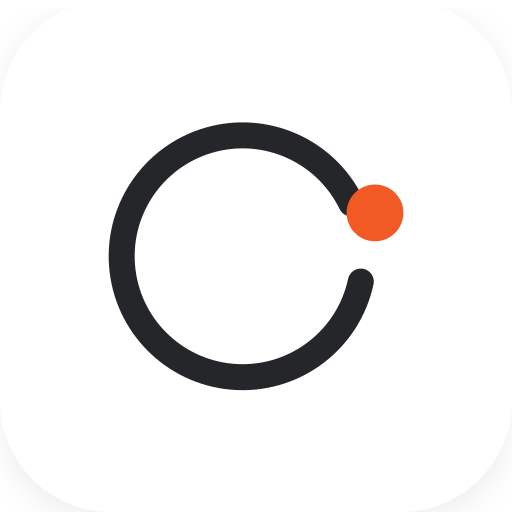
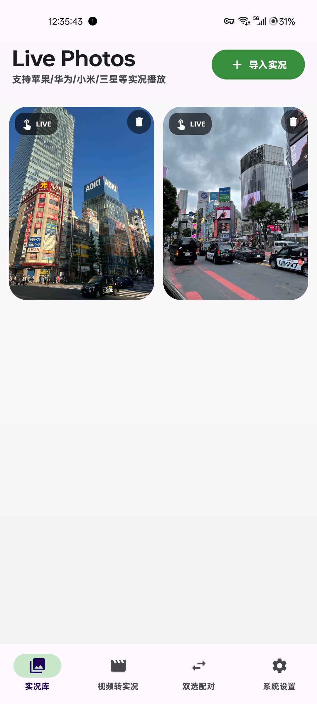
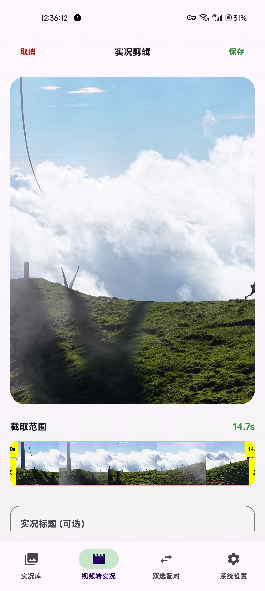
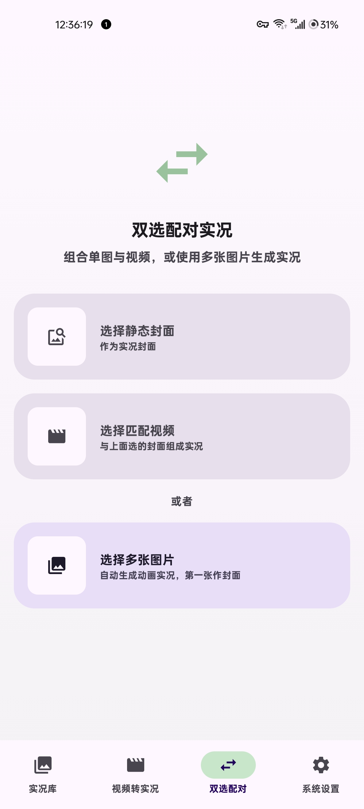
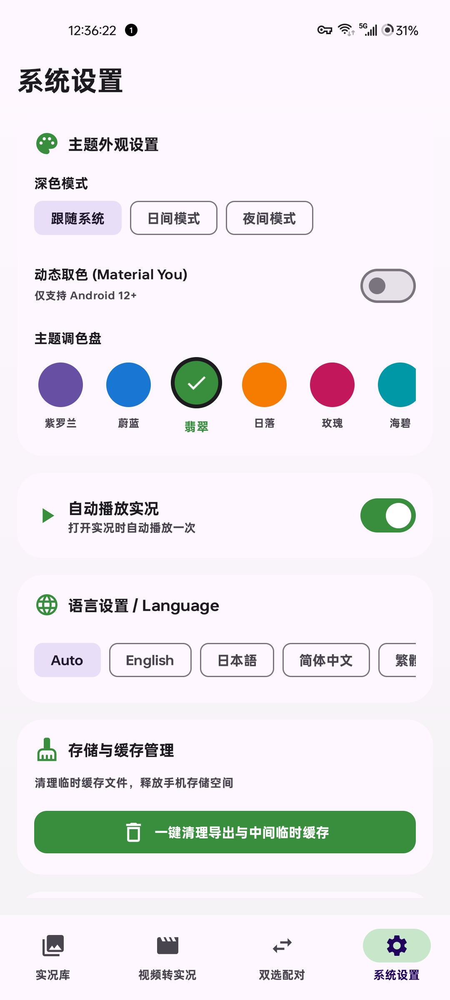

# MotionCraft (Live Photos Studio)

<p align="center">
  
</p>

<p align="center">
  <b>Android Live Photos / Motion Photos viewer, converter, synthesizer, and batch archive importer</b>
</p>

<p align="center">
  <a href="README_zh.md">简体中文</a> | <b>English</b>
</p>

<p align="center">
  <a href="LICENSE"></a>
  <a href="https://kotlinlang.org"></a>
  <a href="https://developer.android.com/jetpack/compose"></a>
  <a href="https://www.android.com/"></a>
  <a href="CHANGELOG.md"></a>
</p>

---

## Project Overview

**MotionCraft** is an Android utility for viewing, converting, and creating Live Photos (Motion Photos).
It supports scanning and playing local motion photos, extracting video clips and still frames, converting videos or image-audio pairs into motion photos, and batch-importing Apple `.livp` / `.zip` archives.

---

## Format and Platform Support

| Platform / Format | Status |
| :--- | :---: |
| **Universal Fusion (`GCamera` + `MicroVideo` + SEF)** | Supported |
| **OPPO / OnePlus / realme Live Photo** | Supported |
| **Xiaomi / Redmi Live Photo** | Supported |
| **Samsung Galaxy Motion Photo** | Supported |
| **vivo / iQOO Live Photo** | Supported |
| **Google Pixel Motion Photo** | Supported |
| **Apple Live Photo (`.livp` / `.zip` Archive Import)** | Supported |

> Live photo implementations vary across manufacturers in XMP/EXIF tags, MP4 box layout, and container structure. MotionCraft writes standard XMP metadata and vendor-specific trailers according to the selected target protocol.

---

## Core Features

- **Live Photo Gallery**: Scans local storage for motion photos, supporting grid preview, search, and batch deletion.
- **Video & Photo to Live Photo**: Trim video clips, pick a cover frame, or combine a still image with audio into a motion photo.
- **Apple `.livp` / `.zip` Batch Import**: Stream-scans archives for `HEIC/JPG + MOV/MP4` pairs, standalone videos, and photos; supports inline preview, category filtering, direct save, and batch conversion.
- **QuickTime `.MOV` Remux & Audio Fix**: Converts QuickTime containers and `lpcm`/`sowt`/`twos` PCM audio tracks into standard ISO MP4 with AAC audio for normal playback and export on Android.
- **Frame & Video Extraction**: Extract still frames (JPG / PNG / WEBP) at any timestamp or export standalone MP4 video clips.
- **Decoder & Stream Settings**: Switch between Auto Fallback, Hardware First, and Software First decoding in Settings.
- **Themes & Localization**: Supports 7 color palettes, light/dark modes, and 4 languages (`zh-CN`, `zh-TW`, `en`, `ru`).

---

## App Screenshots

| Gallery | Video to Live | Dual Pairing | Settings |
| :---: | :---: | :---: | :---: |
|  |  |  |  |
| Local motion photo discovery | Cover extraction & synthesis | Manual picture & video merge | App preferences & themes |

---

## Project Structure

```
MotionCraft/
├── .github/                    # CI/CD workflows and issue templates
├── Screenshot/                 # App preview screenshots and logo
├── app/                        # Main Android application module
│   ├── build.gradle.kts        # Module build configuration (arm64-v8a & R8)
│   ├── proguard-rules.pro      # ProGuard / R8 rules
│   └── src/main/
│       ├── AndroidManifest.xml
│       ├── java/com/example/
│       │   ├── MainActivity.kt
│       │   ├── core/           # Conversion engine, media processor, protocol & ZLC remuxer
│       │   ├── data/           # Room database and local persistence
│       │   ├── ui/             # Jetpack Compose screens, player & components
│       │   ├── util/           # XMP parser, cache manager & runtime logger
│       │   └── viewmodel/      # LivePhotoViewModel state management
│       └── res/                # Icons, localized strings (zh-CN/zh-TW/en/ru) & themes
├── gradle/
│   └── libs.versions.toml      # Gradle Version Catalog
├── build.gradle.kts            # Root build script
├── settings.gradle.kts         # Project settings
├── CHANGELOG.md                # Release notes
├── LICENSE                     # Apache 2.0 License
├── README_zh.md                # Simplified Chinese documentation
└── README.md                   # English documentation
```

---

## Build Instructions

```bash
./gradlew assembleRelease
```

Output directory: `app/build/outputs/apk/release/`

---

## License

This project is licensed under the [Apache 2.0 License](LICENSE).
