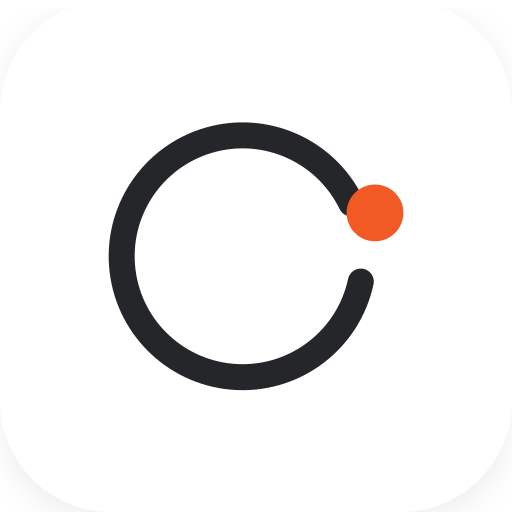
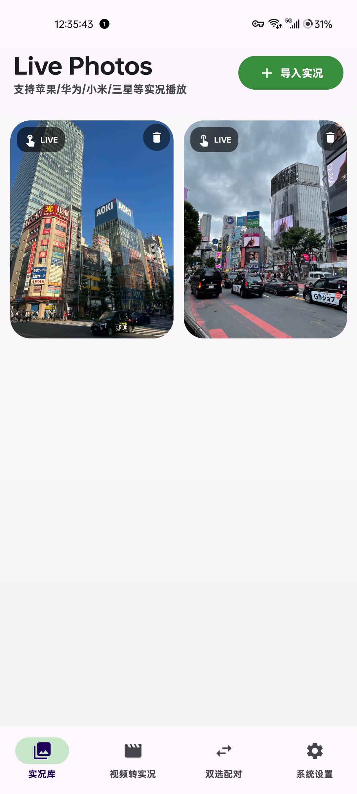
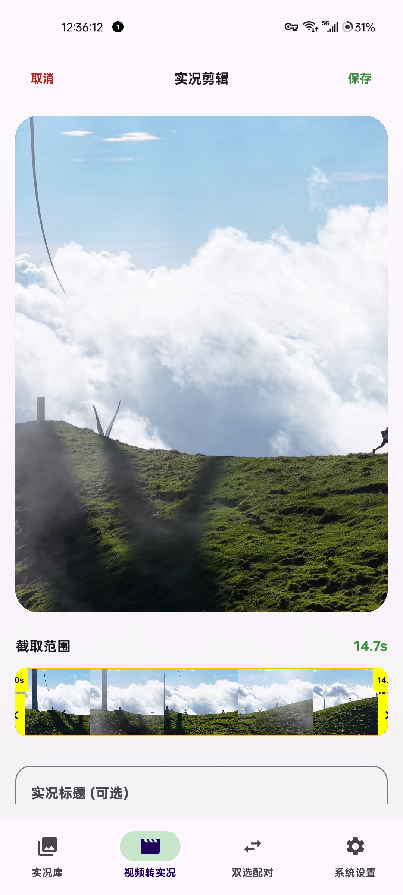
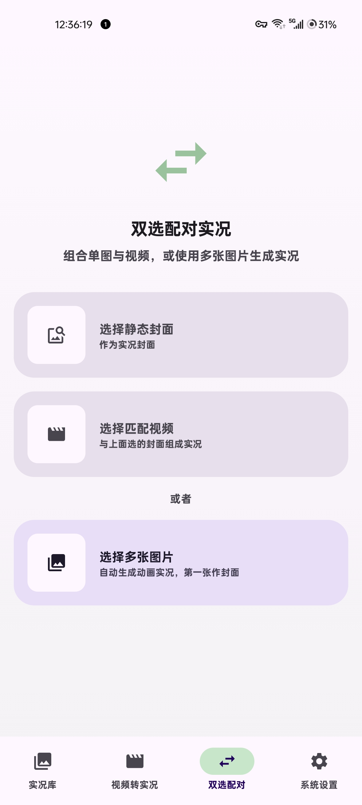
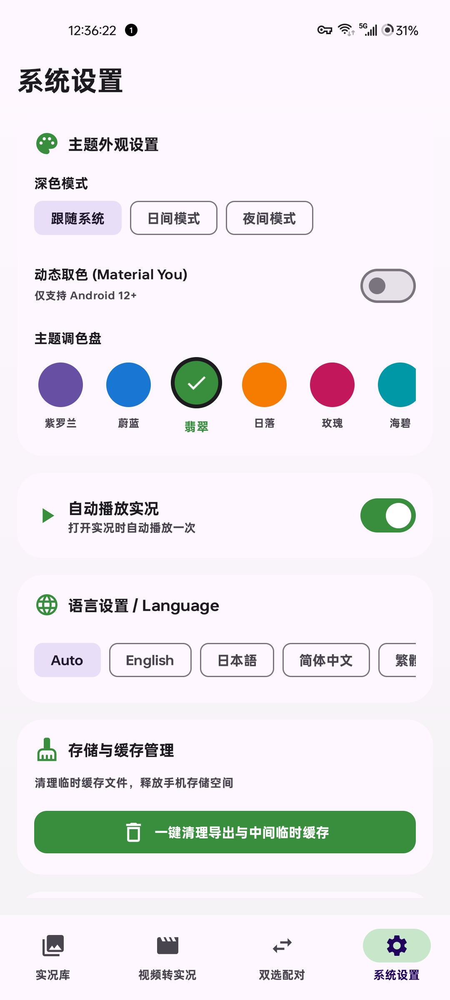

# MotionCraft (Live Photos Studio)

<p align="center">
  
</p>

<p align="center">
  <b>Android 实况照片 (Live Photos / Motion Photos) 查看、转换、合成与压缩包批量导入工具</b>
</p>

<p align="center">
  <b>简体中文</b> | <a href="README.md">English</a>
</p>

<p align="center">
  <a href="LICENSE"></a>
  <a href="https://kotlinlang.org"></a>
  <a href="https://developer.android.com/jetpack/compose"></a>
  <a href="https://www.android.com/"></a>
  <a href="CHANGELOG.md"></a>
</p>

---

## 项目简介

**MotionCraft** 是一款运行于 Android 平台的实况照片处理工具。
支持本地实况照片扫描播放、视频/封面提取、普通视频或图文转实况照片，以及苹果 `.livp` / `.zip` 压缩包批量解压与转换。

---

## 格式与平台支持

| 平台 / 格式 | 状态 |
| :--- | :---: |
| **全品牌通用融合 (`GCamera` + `MicroVideo` + SEF)** | 已支持 |
| **OPPO / 一加 / 真我 实况照片** | 已支持 |
| **小米 / 红米 实况照片** | 已支持 |
| **三星 Galaxy 动态照片** | 已支持 |
| **vivo / iQOO 实况照片** | 已支持 |
| **Google Pixel 动态照片** | 已支持 |
| **Apple Live Photo (`.livp` / `.zip` 压缩包导入)** | 已支持 |

> 不同厂商的实况照片在 XMP、EXIF、MP4 Box 结构及文件尾部标识上存在差异。应用支持按所选的目标品牌协议生成对应的元数据结构。

---

## 核心功能

- **实况图集管理**：扫描本地相册中的实况照片，支持网格预览、搜索筛选与多选批量删除。
- **视频与照片合成实况**：支持截取视频片段并抽帧作为封面，或将静态照片与音频合成为实况照片。
- **苹果 `.livp` / `.zip` 批量导入**：流式解析压缩包内的 `HEIC/JPG + MOV/MP4` 配对项、独立视频与静态照片，支持在线预览、按类型筛选、直存原文件或批量合成为安卓实况照片。
- **QuickTime `.MOV` 容器与音轨修复**：内置 ISOBMFF Box 级转封装与 `lpcm`/`sowt`/`twos` 原始 PCM 转 AAC 音频编码，解决苹果实况视频在安卓设备上无法播放或导出无声的问题。
- **单帧与独立视频导出**：支持按时间戳从实况照片中提取静态图片（JPG / PNG / WEBP）或裁剪导出独立 MP4 视频。
- **播放解码与兼容设置**：支持在设置页切换解码模式（自动回退、优先软解、系统 MediaPlayer）及视频流处理方式。
- **主题与多语言**：内置 7 套配色、深浅色模式，以及简体中文、繁体中文、English、Русский 四种语言。

---

## 应用界面

| 实况图集 | 视频转实况 | 双选配对 | 系统设置 |
| :---: | :---: | :---: | :---: |
|  |  |  |  |
| 本地实况照片识别与展示 | 视频截取封面与合成 | 图片与视频手动合并 | 基础配置与主题设置 |

---

## 项目结构

```
MotionCraft/
├── .github/                    # CI/CD 工作流与 Issue 模板
├── Screenshot/                 # 应用截图与图标
├── app/                        # Android 应用主模块
│   ├── build.gradle.kts        # 模块构建配置 (arm64-v8a 64位过滤与 R8 混淆)
│   ├── proguard-rules.pro      # ProGuard / R8 规则
│   └── src/main/
│       ├── AndroidManifest.xml
│       ├── java/com/example/
│       │   ├── MainActivity.kt
│       │   ├── core/           # 核心转换、音视频处理、品牌协议与 ZLC 转封装工具
│       │   ├── data/           # Room 数据库持久化
│       │   ├── ui/             # Jetpack Compose 界面、播放器与公共组件
│       │   ├── util/           # XMP 解析、缓存清理与运行日志管理
│       │   └── viewmodel/      # LivePhotoViewModel 全局状态管理
│       └── res/                # 图标、多语言资源 (zh-CN/zh-TW/en/ru) 与主题样式
├── gradle/
│   └── libs.versions.toml      # Gradle 依赖版本目录
├── build.gradle.kts            # 根工程构建脚本
├── settings.gradle.kts         # 工程设置配置
├── CHANGELOG.md                # 更新日志
├── LICENSE                     # 开源协议 (Apache 2.0)
├── README_zh.md                # 简体中文说明文档
└── README.md                   # 英文说明文档
```

---

## 构建说明

```bash
./gradlew assembleRelease
```

构建产物目录：`app/build/outputs/apk/release/`

---

## 开源协议

本项目基于 [Apache 2.0 License](LICENSE) 协议开源。
